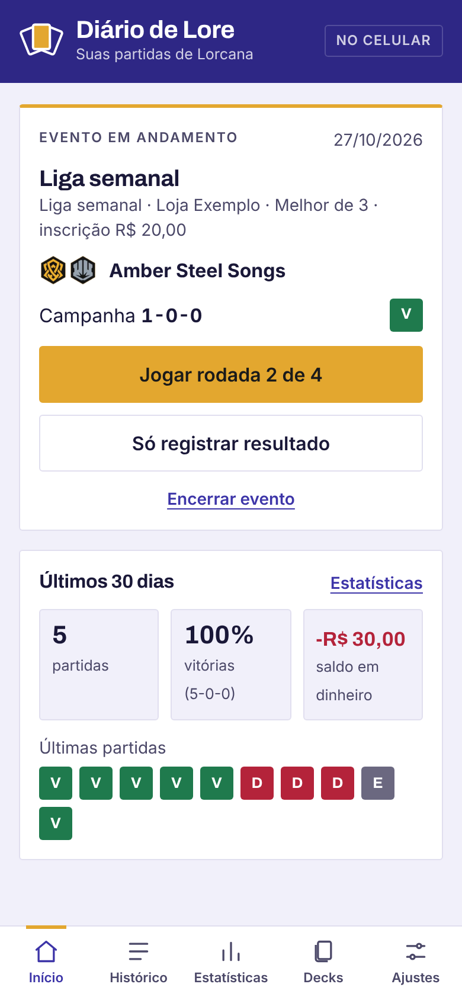
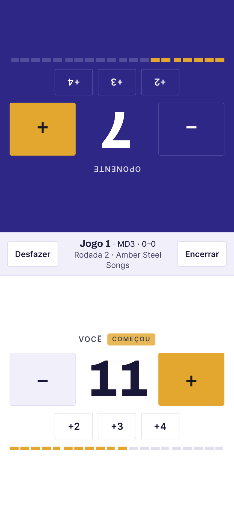
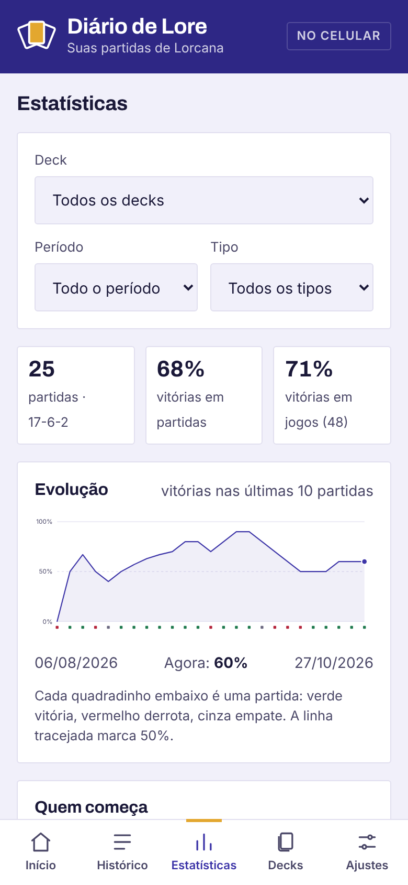
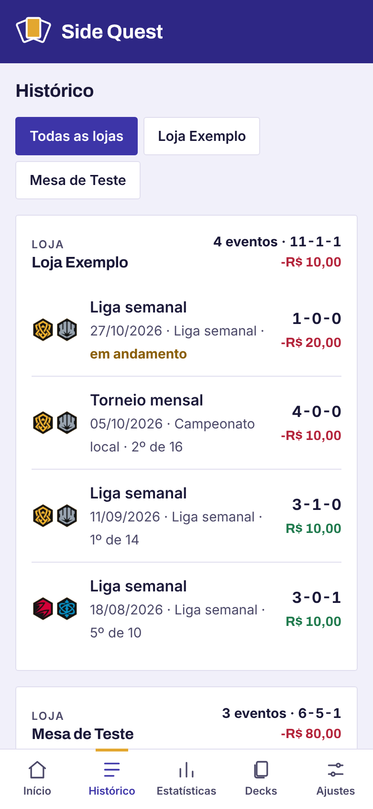

# Diário de Lore

**Contador de lore e diário de partidas de Disney Lorcana.**
Registre eventos, partidas e prêmios, e descubra contra quais decks você vai bem ou mal.

Funciona sem internet e fica instalado no celular como um app.

**[Abrir o app](https://github.com/yas-cm/tcg_app)**

  
  
  
  

Imagens com dados de exemplo.

## O que ele faz

**Antes de jogar**
- Comece o evento já com tudo preenchido: nome, loja, tipo (liga, campeonato…), MD1 ou MD3, rodadas, inscrição e o deck que você vai usar.

**Durante o evento**
- Contador de lore para os dois jogadores, com a metade do oponente virada para o outro lado da mesa.
- Ao chegar a 20 de lore, o resultado do jogo é registrado sozinho. Em MD3, ele já passa para o jogo seguinte.
- Quer só anotar o resultado? Dá para registrar sem usar o contador.
- No fim da partida, é só tocar nas cores do oponente. Decks que você já enfrentou aparecem como sugestão e preenchem as cores sozinhos.
- Etiquetas rápidas e notas para lembrar dos erros e do que mudar no deck.

**Depois**
- Encerramento do evento com colocação e premiação (dinheiro, crédito na loja, boosters e cartas).
- Histórico de eventos separado por loja, com campanha e saldo de cada uma.
- Decks com decklist no formato do duels.ink e histórico do que entrou e saiu.

## Estatísticas

- Taxa de vitória em partidas e em jogos, começando e respondendo.
- Gráfico de evolução (vitórias nas últimas 10 partidas).
- Matchups por cores do oponente, com uma página de notas para cada um.
- Tabela dos seus decks contra os arquétipos que você mais enfrenta.
- Resultado por deck e por tipo de evento.
- Inscrições, prêmios e saldo, separando dinheiro do valor estimado.
- Filtros por deck, período e tipo de evento.
- Exportação em planilha (CSV) e resumo em texto para compartilhar.

## Instalar no celular (Android)

1. Abra o [endereço do app](https://github.com/yas-cm/tcg_app) no Chrome.
2. Toque no menu ⋮ → **Instalar app** (ou **Adicionar à tela inicial**).
3. Abra uma vez pelo ícone. Depois disso ele funciona sem internet.

## Seus dados

- Tudo fica salvo **só no seu celular**. Nada é enviado para nenhum servidor.
- Faça backup em **Ajustes → Exportar backup** depois de cada evento. O app avisa quando faz mais de 7 dias sem backup.
- Para trocar de celular, use **Ajustes → Importar backup**.

## Como é feito

Um único arquivo HTML, com CSS e JavaScript puros, sem frameworks e sem servidor. Um *service worker* guarda o app para uso offline e os dados ficam no armazenamento do navegador.

| Arquivo | Para que serve |
| --- | --- |
| `index.html` | O app inteiro |
| `sw.js` | Guarda o app para funcionar sem internet |
| `manifest.webmanifest` | Nome, cores e ícones para instalar no celular |
| `icon-*.png` | Ícones do app |

## Aviso

Projeto de fã, não oficial, feito para uso pessoal. Disney Lorcana e os símbolos das tintas são marcas e propriedade da Disney e da Ravensburger. Este projeto não é afiliado, patrocinado nem aprovado por elas.
